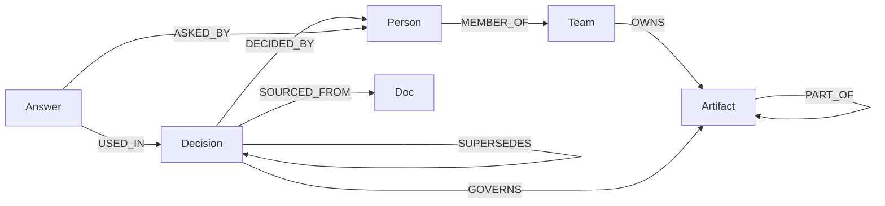

# Gatekeeper

> TODO: final submission metadata, screenshots, demo video, deployment URL, and teammate-owned sections are intentionally left open.

## Problem + idea

Companies reverse decisions, but old answers continue circulating. Gatekeeper is a check-before-you-act system: it resolves an artifact/action against a decision graph, follows the decisions' premises, and returns a verdict plus the evidence path it used.

The key rule is liveness through premises: a decision is live only if its own status is live and every premise it depends on is live within the requested depth. A dead premise produces `STALE`, not `ALLOW`.

## Track 3 / Company Brain mapping

- Connects decisions, people, teams, artifacts, and source records in one graph.
- Resolves owners through artifact hierarchy.
- Traces a decision back to docs, tickets, threads, and its decider.
- Keeps reversal state explicit with `SUPERSEDES` and a dry-run ripple preview.
- Returns graph paths with answers instead of a free-floating model sentence.
- Says `UNKNOWN_TARGET` / “not in the graph” rather than guessing.

## Data model

The complete schema is in [`engine/SCHEMA.md`](engine/SCHEMA.md). The engine contract is in [`engine/ENGINE_CONTRACT.md`](engine/ENGINE_CONTRACT.md).



## Verdict semantics

1. `UNKNOWN_TARGET`: the target name does not resolve.
2. `BLOCK`: a live high-severity prohibition covers the action.
3. `ESCALATE`: a live prohibition or approval requirement needs an owner.
4. `STALE`: a live governing decision has a dead premise; confirm with the owner.
5. `ALLOW`: only dead or informational governance remains, with history.
6. `UNGOVERNED`: nothing recorded covers the action; this is not safe.

Depth is validated from 1 through 6. Depth 1 is deliberately shallow; depth 4+ is the full check used in the demo.

## Cypher queries the product depends on

The complete fixed query catalogue is [`engine/QUERIES.md`](engine/QUERIES.md). Values stay parameterized; only a validated bounded depth is formatted.

### Resolve before traversal

```cypher
MATCH (a:Artifact {id: $target})
RETURN a.id AS id, a.kind AS kind, a.name AS name
LIMIT 1
```

### Inherited governance

```cypher
MATCH (target:Artifact {id: $target})
OPTIONAL MATCH (target)-[:PART_OF*1..4]->(parent:Artifact)
WITH collect(DISTINCT target) + collect(DISTINCT parent) AS scopes
UNWIND scopes AS scope
MATCH (d:Decision)-[g:GOVERNS]->(scope)
RETURN DISTINCT d.id, d.status, g.constraint, g.actions, g.severity, scope.id
```

### Dead premise proof

```cypher
MATCH p = (d:Decision {id: $decision})-[:DEPENDS_ON*1..4]->(premise:Decision)
WHERE premise.status <> 'live' OR premise.id IN $overrides
WITH premise.id AS id, min(length(p)) AS hops, collect(p) AS paths
RETURN id, hops, [node IN nodes(paths[0]) | node.id] AS via
```

## Setup

### FalkorDB

The pinned image is `falkordb/falkordb:v4.22.1`.

```bash
# from gatekeep/
docker compose up -d falkordb
# or, with Podman Compose:
podman compose up -d falkordb
# direct fallback when no compose command is installed:
podman run -d --name gatekeep-falkordb \
  -p 6379:6379 -p 3000:3000 \
  -v gatekeep-falkordb-data:/data \
  docker.io/falkordb/falkordb:v4.22.1
```

### Engine

```bash
cd engine
python3.12 -m venv .venv
. .venv/bin/activate
python -m pip install -r requirements.txt
PYTHONPATH=. pytest -q
PYTHONPATH=. python demo.py
```

### Frontend

```bash
cd frontend
npm install
npm run dev
```

## Real vs curated vs synthetic

- **Synthetic:** the current fixture, people, decisions, artifacts, sources, answers, governance edges, premise edges, and example outputs.
- **Curated:** three hand-written notes for the three PEP records, marked `CURATED`.
- **Real:** three PEP records and three source documents from `python/peps`, retrieved over HTTP and stored offline. The source snapshot has not been pinned to a repository commit in this workspace.

## Limitations

See [`engine/LIMITS.md`](engine/LIMITS.md). The short version: advisory only, recorded knowledge only, bounded traversal, curated governance, synthetic fixture, and a ledger that means retrieved rather than causally used.

## Test results

These are the checks run in this workspace; update only with results actually rerun:

```text
Engine: PYTHONPATH=. .venv/bin/pytest -q — 30 passed (Python 3.11.2, FalkorDB v4.22.1)
Backend: RESET_TOKEN=test-token PYTHONPATH=.:../engine .venv/bin/pytest -q — 3 passed
Data: PYTHONPATH=. .venv/bin/pytest ../data/test_loader.py -q — 1 passed
E2E: RESET_TOKEN=test-token BASE_URL=http://127.0.0.1:8001 backend/.venv/bin/python scripts/e2e_smoke.py — PASS
Frontend: npm run test — 3 passed
Frontend: npm run build — passed; Vite emitted a chunk-size warning over 500 kB
Examples: PYTHONPATH=. .venv/bin/python make_examples.py — passed
Demo: PYTHONPATH=. .venv/bin/python demo.py — printed ESCALATE, BLOCK, UNGOVERNED, and the depth flip to STALE
```

## AI USE DISCLOSURE

Codex was used to generate the frontend and engine code under the team lead's direction. The team is responsible for reviewing it and must be able to explain the graph model, fixed Cypher, verdict engine, tests, and limitations.

TODO: teammates add any other tools/models used in their lanes and their review notes.

## Data ingestion and backend

- The bounded PEP snapshot and loader are under [`data/`](data/README.md). It contains three verified records, not a 60–150 record corpus.
- The FastAPI adapter is under [`backend/`](backend/README.md). `/ask` is deterministic and router-based; no LLM key is required.
- MCP was not added.

## TODO: frontend screenshots + demo video / teammate 4

- Add screenshots.
- Add demo video link.
- Record the depth-1 vs depth-4 reversal flow.

## TODO: deployment URL

- Add the final public deployment URL once the backend and graph service are deployed.
