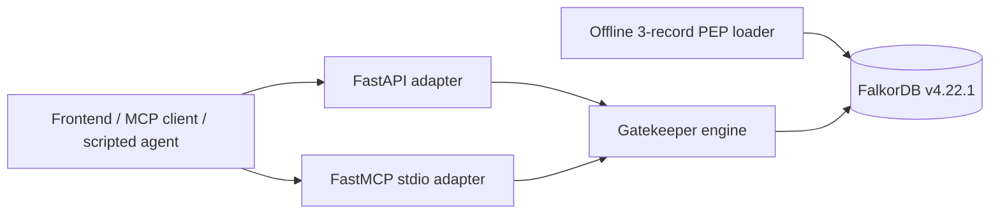

# Gatekeeper

Gatekeeper is a deterministic check-before-you-act system for company decisions.
It resolves an artifact and action against a FalkorDB decision graph, follows
recorded premises, and returns one of `BLOCK`, `ESCALATE`, `STALE`, `ALLOW`,
`UNGOVERNED`, or `UNKNOWN_TARGET` with the evidence path used. The engine is
authoritative: no LLM chooses a verdict or writes Cypher.

## Track mapping

For the Graph Hacks company-brain track, Gatekeeper connects decisions, people,
teams, artifacts, source records, and recorded answers in one graph. It resolves
owners through artifact hierarchy, exposes why a decision exists, previews a
reversal before writing it, and gives MCP clients a tool they can call before a
risky action. The current real-data work is only a small three-record PEP proof
of concept; it is not a real dependency-chain corpus.

## Architecture



- `engine/` owns validation, fixed parameterized Cypher, liveness, verdict
  aggregation, reversal behavior, audits, and the answer ledger.
- `backend/` provides the FastAPI HTTP adapter.
- `backend/mcp/` provides the official Python MCP SDK/FastMCP adapter. Stdio is
  the default transport; streamable HTTP is an SDK option.
- `frontend/` is the React/Vite console. It can use the stateful mock or the
  live FastAPI adapter.
- `data/` contains the offline three-record PEP proof of concept and curated
  notes. It does not contain a 60–150 record chain.

## Graph model

The complete schema is [`engine/SCHEMA.md`](engine/SCHEMA.md). The important
directions are:

```text
Person -[:MEMBER_OF]-> Team -[:OWNS]-> Artifact
Artifact -[:PART_OF]-> Artifact
Decision -[:GOVERNS]-> Artifact
Decision -[:DEPENDS_ON]-> Decision
new Decision -[:SUPERSEDES]-> old Decision
Decision -[:DECIDED_BY]-> Person
Decision -[:SOURCED_FROM]-> Doc/Ticket/Thread
Answer -[:USED_IN]-> Decision
Answer -[:ASKED_BY]-> Person
```

## Verdict semantics

- `BLOCK`: a live high-severity prohibition covers the action; stop.
- `ESCALATE`: a live recorded rule requires an owner or approval.
- `STALE`: a governing rule has a dead premise; it is not permission.
- `ALLOW`: no live non-informational rule blocks or requires approval after the
  recorded history is considered. It is still an advisory graph result.
- `UNGOVERNED`: nothing recorded covers the action; this is not evidence that
  the action is acceptable.
- `UNKNOWN_TARGET`: the target is not recorded; Gatekeeper does not guess.

Depth is a validated integer from 1 through 6. The synthetic hero chain is
`D2 -> D5 -> D6 -> D1`: fresh shim deletion is `ESCALATE`, reversing `D1` makes
the full-depth result `STALE`, and depth 1 remains `ESCALATE`.

## Fixed Cypher

The full query catalogue is [`engine/QUERIES.md`](engine/QUERIES.md). Inputs
remain parameters; only the validated bounded depth is formatted into the
variable-length query template.

### Resolve an artifact

```cypher
MATCH (a:Artifact {id: $target})
RETURN a.id AS id, a.kind AS kind, a.name AS name
LIMIT 1
```

### Find inherited governance

```cypher
MATCH (target:Artifact {id: $target})
OPTIONAL MATCH (target)-[:PART_OF*1..4]->(parent:Artifact)
WITH collect(DISTINCT target) + collect(DISTINCT parent) AS scopes
UNWIND scopes AS scope
MATCH (d:Decision)-[g:GOVERNS]->(scope)
RETURN DISTINCT d.id, d.status, g.constraint, g.actions, g.severity, scope.id
```

### Prove a dead premise

```cypher
MATCH p = (d:Decision {id: $decision})-[:DEPENDS_ON*1..4]->(premise:Decision)
WHERE premise.status <> 'live' OR premise.id IN $overrides
WITH premise.id AS id, min(length(p)) AS hops, collect(p) AS paths
RETURN id, hops, [node IN nodes(paths[0]) | node.id] AS via
```

## Local setup

The commands below are for a fresh checkout on a machine using Podman. Docker
Compose can be substituted where available. The user's machine uses host port
`6380` because `6379` is already occupied; all application code reads the port
from `FALKORDB_PORT`.

### FalkorDB

```bash
cd gatekeep
cp .env.example .env
set -a; . ./.env; set +a
podman run -d --name gatekeep-falkordb \
  -p "${FALKORDB_PORT:-6380}:6379" \
  -p "${FALKORDB_BROWSER_PORT:-3000}:3000" \
  -v gatekeep-falkordb-data:/data \
  docker.io/falkordb/falkordb:v4.22.1
```

If the container already exists, use `podman start gatekeep-falkordb`. The
existing development `docker-compose.yml` starts FalkorDB only; production
packaging was intentionally not added in this run.

### Engine environment and tests

```bash
cd gatekeep/engine
python3 -m venv .venv
. .venv/bin/activate
python -m pip install -r requirements.txt
FALKORDB_HOST=127.0.0.1 FALKORDB_PORT=6380 PYTHONPATH=. .venv/bin/pytest -q
```

### Backend

```bash
cd gatekeep/backend
python3 -m venv .venv
. .venv/bin/activate
python -m pip install -r requirements.txt
cd ..
export FALKORDB_HOST=127.0.0.1 FALKORDB_PORT=6380
export RESET_TOKEN=local-development-token
export PYTHONPATH=backend:engine
backend/.venv/bin/uvicorn app.main:app --host 127.0.0.1 --port 8000
```

### Frontend in live mode

In another shell:

```bash
cd gatekeep/frontend
npm ci
VITE_USE_MOCK=false VITE_API_URL=http://127.0.0.1:8000 npm run dev
```

To use the deterministic fixture instead, omit `VITE_USE_MOCK=false` or set
`VITE_USE_MOCK=true`. The frontend's live API mode does not imply that every
graph record is real; provenance comes from returned graph records.

### Reset and data mode

```bash
curl -X POST -H "X-Reset-Token: $RESET_TOKEN" http://127.0.0.1:8000/reset
```

`GATEKEEPER_LOAD_REAL=0` resets to the clean synthetic fixture. The default
`GATEKEEPER_LOAD_REAL=1` also loads the offline three-record PEP proof of
concept from `data/`; it does not use the network at reset time. The loader
adds three real PEP decisions, three real source documents, and three curated
note documents, with no real dependency chain.

## MCP server and scripted agent

Install the backend requirements, start FalkorDB, and run:

```bash
cd gatekeep
FALKORDB_HOST=127.0.0.1 FALKORDB_PORT=6380 FALKORDB_GRAPH=gatekeeper \
PYTHONPATH="$PWD/engine" "$PWD/backend/.venv/bin/python" \
"$PWD/backend/mcp/server.py"
```

The default catalogue has eight tools: `check_action`, `why`, `who`,
`affected`, `list_targets`, `list_decisions`, `audit`, and `reverse_preview`.
`reverse_commit` does not exist unless `GATEKEEPER_MCP_ALLOW_WRITE=1` is set in
the server process. This is a deliberate default because agents must not be
able to rewrite company decisions without an explicit administrative choice.

The deterministic screen-recording demo is:

```bash
cd gatekeep
FALKORDB_HOST=127.0.0.1 FALKORDB_PORT=6380 \
PYTHONPATH=engine backend/.venv/bin/python scripts/agent_demo.py
```

`agent_demo.py` is a scripted stand-in, not an LLM. It checks shim deletion,
adding moment, readme deletion, an unknown target, then previews and commits
the D1 reversal through the explicitly write-enabled MCP server.

Client configuration snippets and the MCP test details are in
[`backend/mcp/README.md`](backend/mcp/README.md). The SDK client and stdio
subprocess were tested here; Claude Desktop, Claude Code, and Cursor were not
installed here and their snippets were not client-tested.

## Real, curated, and synthetic

- **Synthetic:** the hero graph, its decisions, artifacts, people, teams,
  governance edges, answer fixture, and generated examples under
  `engine/examples/`.
- **Real:** three offline PEP records and their three real source documents,
  loaded from the checked-in `data/pep_slice.json` proof of concept.
- **Curated:** three notes associated with those records under the loader's
  curated-note layer. The current data slice does not create a real
  `DEPENDS_ON`/`SUPERSEDES` chain or real governance mappings.

## Limitations

See [`engine/LIMITS.md`](engine/LIMITS.md). In brief: the product is advisory,
knowledge is limited to graph records, traversal is bounded, the PEP data is a
small proof of concept, and governance in the synthetic fixture is authored
graph data. `/ask` is a deterministic router, not an LLM. The backend reset
rate limiter and reverse lock are single-process controls. No production
deployment packaging was added in this run.

## Checks actually run

These are results from this workspace, not claims about an unrun environment:

```text
Engine baseline and Phase 1 regression: 30 passed
Backend baseline and Phase 1 regression: 3 passed, 1 deprecation warning
Data baseline: 1 passed
MCP tests: 9 passed
E2E smoke: PASS
Frontend baseline: 7 test files, 24 tests passed; build passed with Vite >500 kB warning
Examples: reran engine/make_examples.py; engine/examples/ diff clean
```

Representative commands are in the component READMEs and in
`.codex_progress.md` (ignored local progress log).

## AI use disclosure

Codex generated the engine, backend, frontend, MCP, and data code under the
lead's direction. The lead reviews the implementation and must be able to
explain the fixed Cypher, graph model, verdict order, MCP write gate, tests,
and limitations. One teammate's frontend commits are preserved in history.

Teammate review line: teammates can add any other tools/models used in their
lanes and their review notes here.

## Submission TODOs

- TODO: demo video link.
- TODO: deployment URL (no deployment was created in this run).
- TODO: screenshots.
