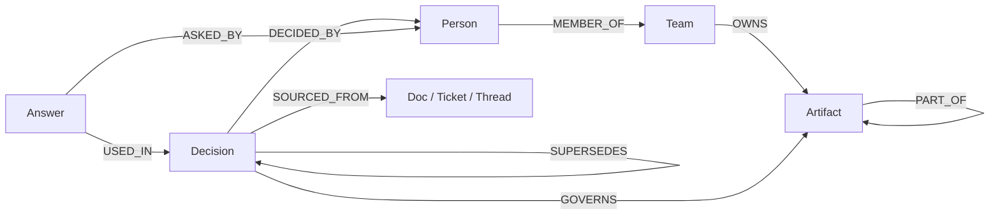

# Gatekeeper engine: a spoken explanation

This document describes the code in this directory. The query rows below were run
against the synthetic FalkorDB fixture. They are not claims about a real corpus.

## 1. The 60 second pitch

- Gatekeeper checks whether an action is supported by recorded decisions.
- The action has a target, such as `file:compat/win7_shim.js`.
- The engine follows artifact hierarchy, governance rules, and decision dependencies.
- It returns a verdict and an evidence path.
- The main verdicts are `BLOCK`, `ESCALATE`, `STALE`, `ALLOW`, and `UNGOVERNED`.
- `UNKNOWN_TARGET` is used when the target is not in the graph.
- A graph fits this problem because the important facts are connected:
  - a file is part of a module;
  - a module is part of a repository;
  - a decision governs an artifact;
  - a decision depends on another decision;
  - a decision has a source and a decider.
- A vector database finds similar text. Similarity does not prove these exact links.
- A vector result might find a paragraph about a module, but it does not by itself
  tell us which decision governs a child file or whether that decision depends on
  an expired premise.
- Gatekeeper uses fixed Cypher written by the engine. The caller does not write
  Cypher and an LLM does not choose the verdict.

## 2. The data model in one picture



The central objects are `Artifact` and `Decision`. A `GOVERNS` edge says what a
decision says about an artifact. Its properties include the constraint, actions,
severity, and provenance. `DEPENDS_ON` connects a decision to an older premise.
`SUPERSEDES` records a replacement decision. Source nodes provide provenance.
`Answer` nodes are the engine's ledger entries. The fixture has 21 nodes and 26
edges after seeding, but that is only the demo fixture.

## 3. Hero scenario: deleting the Windows 7 shim

The spoken story is:

1. Someone asks to delete `file:compat/win7_shim.js`.
2. The engine confirms that the artifact exists.
3. It finds the artifact's parent scopes: `module:compat` and `repo:app`.
4. It finds a rule on `module:compat`: deleting or modifying it requires approval.
5. It follows the rule's decision chain: `D2 -> D5 -> D6 -> D1`.
6. On the fresh fixture, all four decisions are live, so the result is `ESCALATE`.
7. The owner query finds team `platform` and person `bob`.
8. The response includes the graph path. If a viewer is supplied, the result is
   also recorded as an `Answer` in the ledger.

The normal public call is:

```python
engine.check("file:compat/win7_shim.js", "delete", depth=6)
```

On a fresh fixture, the actual response was `ESCALATE`. It contained owner
`platform / bob`, live decision `D2`, no stale or dead decisions, and the path
`file:compat/win7_shim.js -> D2 -> D5 -> D6 -> D1`.

The important fixed queries are below. `$target` and `$decision` are parameters.
They are not string-concatenated into Cypher.

### Query 1: resolve the target

```cypher
MATCH (a:Artifact {id: $target})
RETURN a.id AS id, a.kind AS kind, a.name AS name
LIMIT 1
```

- `MATCH` looks for an `Artifact` whose `id` equals the supplied target.
- `RETURN` sends back the id, kind, and display name.
- `LIMIT 1` makes this a single-target lookup.

Actual fixture rows for `$target = "file:compat/win7_shim.js"`:

```text
[['file:compat/win7_shim.js', 'file', 'win7_shim.js']]
```

### Query 2: find parent artifact scopes

```cypher
MATCH (a:Artifact {id: $target})
OPTIONAL MATCH p = (a)-[:PART_OF*1..4]->(parent:Artifact)
RETURN a.id AS id, a.kind AS kind, a.name AS name,
       CASE WHEN parent IS NULL THEN [] ELSE [n IN nodes(p) | n.id] END AS parent_path
```

- The first line finds the target artifact.
- `OPTIONAL MATCH` means the target can have no parent and still be returned.
- `[:PART_OF*1..4]` follows one to four parent edges.
- `nodes(p)` turns the path into a list of node ids.
- The engine uses these paths to build the target's scope list.

Actual fixture rows:

```text
[
  ['file:compat/win7_shim.js', 'file', 'win7_shim.js',
   ['file:compat/win7_shim.js', 'module:compat']],
  ['file:compat/win7_shim.js', 'file', 'win7_shim.js',
   ['file:compat/win7_shim.js', 'module:compat', 'repo:app']]
]
```

### Query 3: find governing decisions

```cypher
MATCH (target:Artifact {id: $target})
OPTIONAL MATCH (target)-[:PART_OF*1..4]->(parent:Artifact)
WITH collect(DISTINCT target) + collect(DISTINCT parent) AS scopes
UNWIND scopes AS scope
MATCH (d:Decision)-[g:GOVERNS]->(scope)
RETURN DISTINCT d.id AS decision, d.title AS title, d.status AS status,
       d.decided_at AS decided_at, g.constraint AS constraint,
       g.actions AS actions, g.severity AS severity, scope.id AS scope,
       coalesce(g.provenance, 'SYNTHETIC') AS provenance
```

- The first two lines collect the file and its parents.
- `collect` makes one list of possible scopes.
- `UNWIND` turns that list back into one row per scope.
- The next `MATCH` finds decisions with `GOVERNS` edges to those scopes.
- The last lines return rule details, including allowed actions and severity.

Actual fixture row:

```text
[['D2', 'Keep win7 shim in compat module', 'live', '2021-06-01',
  'requires_approval', 'delete,modify', 'normal', 'module:compat', 'SYNTHETIC']]
```

`D2` applies to `delete`, so it is applicable to this request.

### Query 4: find dead premises

For depth 6, `queries.py` creates this fixed statement:

```cypher
MATCH (d:Decision {id: $decision})
MATCH p = (d)-[:DEPENDS_ON*1..6]->(premise:Decision)
WHERE premise.status <> 'live'
WITH premise.id AS id, premise.title AS title, premise.status AS status,
     min(length(p)) AS hops, collect(p) AS paths
RETURN id, title, status, hops,
       [node IN nodes(paths[0]) | node.id] AS via
ORDER BY hops, id
```

- It starts at the governing decision.
- It follows dependency edges for one to six hops.
- It keeps premises that are not live.
- `min(length(p))` reports the shortest found path.
- `via` shows the ids along one shortest proof path.
- On a fresh fixture, `$decision = "D2"` returns no rows:

```text
[]
```

The dependency lookup used when building the evidence path returns:

```text
D2 -> [['D5', 'Keep polyfill layer', 'live', '2021-05-01', 'SYNTHETIC']]
D5 -> [['D6', 'Ship legacy-compatible bundles', 'live', '2021-04-01', 'SYNTHETIC']]
D6 -> [['D1', 'Support Windows 7 clients', 'live', '2021-03-01', 'SYNTHETIC']]
D1 -> []
```

### Query 5: find the owner

```cypher
MATCH (target:Artifact {id: $target})
OPTIONAL MATCH (target)-[:PART_OF*0..4]->(scope:Artifact)
OPTIONAL MATCH (team:Team)-[:OWNS]->(scope)
OPTIONAL MATCH (person:Person)-[:MEMBER_OF]->(team)
RETURN DISTINCT scope.id AS scope, team.name AS team,
       collect(DISTINCT person.handle) AS people
```

- It includes the target and all parent scopes.
- It looks for a team that owns each scope.
- It then finds people in that team.
- The owner is the first non-empty owner returned by the engine.

Actual fixture rows:

```text
[
  ['repo:app', None, []],
  ['module:compat', 'platform', ['bob']],
  ['file:compat/win7_shim.js', None, []]
]
```

The response therefore names `platform` and `bob` as the recorded owner.

### Query 6: record the answer in the ledger

For this scenario, the seeded ledger query returns the existing related answers:

```cypher
MATCH (answer:Answer)-[:USED_IN]->(decision:Decision {id: $decision})
MATCH (answer)-[:ASKED_BY]->(person:Person)
RETURN DISTINCT person.handle AS person, answer.id AS answer_id,
       answer.at AS at, answer.summary AS summary, answer.verdict AS answer_value,
       answer.target AS target, answer.action AS action
ORDER BY answer.at
```

For `$decision = "D2"`, the actual rows are:

```text
[
  ['alice', 'ans-021', '2025-02-03T09:12:00Z',
   'Deletion of win7_shim.js needs platform approval.', 'ESCALATE',
   'file:compat/win7_shim.js', 'delete'],
  ['carol', 'ans-034', '2025-04-18T15:41:00Z',
   'Ask platform before removing the Windows 7 shim.', 'ESCALATE',
   'file:compat/win7_shim.js', 'delete']
]
```

The public `check` call also writes a new `Answer` for the supplied viewer. It
stores the summary, target, action, verdict, time, and decision ids used in the
path.

## 4. Why the verdict order is strict

The code checks these cases in this order after it has classified each governing
decision:

1. **`BLOCK`**: a live, high-severity `prohibits` rule matches the action.
2. **`ESCALATE`**: another live non-informational rule matches. It may prohibit
   the action or require approval, but it is not the high-severity block case.
3. **`STALE`**: a live governing rule exists, but a required premise is dead.
4. **`ALLOW`**: only dead or informational rules remain.
5. **`UNGOVERNED`**: no rule covers this action.

The order prevents a weaker result from hiding a stronger one. A high-severity
prohibition must not become an escalation just because another live rule also
exists. A stale rule must not become an allow because its text still exists.

`STALE` is not `ALLOW` because a dead premise means the current rule depends on
an expired or superseded reason. The engine does not know that the action is safe.
It says the rule needs confirmation. `UNGOVERNED` is also not safe: it means the
graph has no recorded rule for that action.

The fixture demonstrates the high-severity case:

```text
target: package:moment
verdict: BLOCK
```

Its `D8` rule is `prohibits`, covers `add_dependency`, and has severity `high`.

## 5. Depth and the Cypher parameter problem

`depth` limits how far the engine follows `DEPENDS_ON` edges. The public API
accepts integers from 1 through 6. A shallow depth can miss a dead premise. That
is deliberate: the result is only complete within the requested bound.

The engine cannot use this form on the tested FalkorDB version:

```cypher
MATCH p = (d:Decision {id: $decision})-[:DEPENDS_ON*1..$depth]->(q:Decision)
```

The real error observed against FalkorDB v4.22.1 was:

```text
ResponseError: Encountered unhandled type in inlined properties.
```

The safe workaround is `dead_premises_query(depth)`. Python validates that the
value is an integer from 1 through 6, then inserts only that bounded integer into
the fixed query template. Decision ids, target ids, and all other values remain
parameters. The engine never inserts an arbitrary user string into Cypher.

## 6. Reverse dry run and the overrides trick

The reverse operation asks what would change if old decision `D1` were replaced.
It has two modes:

- `dry_run=True` reads and predicts. It does not write.
- `dry_run=False` performs the `REVERSE_COMMIT` write.

The dry run works as follows:

1. Find decisions that depend on `D1`, including `D1` itself.
2. Find their governed target/action pairs.
3. Run the normal check for every pair.
4. Run the same check again with `overrides=["D1"]`.
5. In the override query, `D1` is treated as a dead premise even though the
   stored graph has not changed.
6. Return only pairs whose verdict changed.

The override query is:

```cypher
MATCH (d:Decision {id: $decision})
MATCH p = (d)-[:DEPENDS_ON*1..6]->(premise:Decision)
WHERE premise.status <> 'live' OR premise.id IN $overrides
WITH premise.id AS id, premise.title AS title, premise.status AS status,
     min(length(p)) AS hops, collect(p) AS paths
RETURN id, title, status, hops,
       [node IN nodes(paths[0]) | node.id] AS via
ORDER BY hops, id
```

With `$decision = "D2"` and `$overrides = ["D1"]`, the actual row is:

```text
[['D1', 'Support Windows 7 clients', 'live', 3,
  ['D2', 'D5', 'D6', 'D1']]]
```

The stored status is still `live`; the override logic changes the response status
to `superseded` for this simulated check. That makes `D2` stale in the prediction.

The commit query is separate:

```cypher
MATCH (old:Decision {id: $old})
MERGE (new:Decision {id: $new_id})
  ON CREATE SET new.title = $new_title,
                new.status = 'live',
                new.decided_at = $decided_at
  ON MATCH SET new.title = $new_title,
               new.status = 'live'
MERGE (new)-[:SUPERSEDES {provenance: 'SYNTHETIC'}]->(old)
SET old.status = 'superseded'
RETURN old.id AS old, new.id AS new_id, old.status AS old_status, new.status AS new_status
```

The test suite compares the prediction with a real commit on a fresh graph. It
checks that the predicted flip is `ESCALATE -> STALE`, then commits the reversal
and checks the graph-derived result again.

## 7. The ledger

The ledger is made of `Answer` nodes and these edges:

- `Answer -[:ASKED_BY]-> Person`
- `Answer -[:USED_IN]-> Decision`

An answer records an id, timestamp, kind, summary, session, target, action, and
verdict. The engine writes an answer when `check()` is called with a viewer. It
also records answers for unknown targets, with no decision ids.

The ledger can answer questions such as:

- Which recorded people asked questions that used this decision?
- Which previous answers are connected to a decision that may now be stale?

It does **not** prove that a person read the answer, followed it, or caused an
action. It only covers answers given through this engine. It is evidence of a
recorded engine interaction, not an audit of every human action.

## 8. Audit and the fault injection number

`audit()` checks several graph properties:

- bounded dependency cycles;
- live decisions whose reachable premises are all dead;
- live decisions with live incoming supersession edges;
- duplicate live superseders;
- orphan decisions;
- orphan artifacts;
- live governing rules that produce `STALE`.

The fault helper creates a temporary graph, seeds it, injects up to five known
fault categories, runs the audit, and deletes that graph. The verified fixture
run detected all five injected categories: **5/5, detection rate 1.0**.

That number is not production accuracy. It is a small synthetic test where the
faults were chosen to match the audit queries. It does not measure whether a real
corpus has been modeled correctly.

## 9. Judge questions

### Why not a vector database?

Vectors are useful for finding similar text. They do not prove exact ownership,
dependency, or supersession edges. Gatekeeper uses explicit graph links for the
decision that must be explained.

### What if the graph is wrong?

The engine can only reason over recorded graph state. A wrong or missing edge can
produce a wrong result. The audit tools find some structural problems, but they
cannot prove that the source data itself is true.

### What stops an LLM from hallucinating a verdict?

The engine does not use an LLM to choose a verdict or write Cypher. It validates
the action and depth, runs fixed queries, and applies ordinary Python branches.
An LLM outside this engine could still describe results badly, so the adapter
needs its own controls.

### Is this just an access-control system?

No. It does not grant or deny a permission and it does not stop an operation.
It explains recorded governance, including stale premises, evidence paths, and
affected answers. It is advisory.

### How does it scale past a toy?

The current fixture is small and the traversals are bounded. The client uses a
redis-py connection pool and fresh graph wrappers, and read checks were tested
with eight concurrent workers. A production scale claim still needs larger data,
indexes, latency measurements, and a write-concurrency design.

### What is real, curated, and synthetic?

Every source and relationship can carry `REAL`, `CURATED`, or `SYNTHETIC`
provenance. The current demo fixture is synthetic. Missing provenance defaults to
`SYNTHETIC` for compatibility, which is a fallback label, not proof of origin.

### What happens with cycles?

Traversal queries have a maximum depth, and Python evidence-path construction uses
visited sets. The cycle audit reports bounded cycles. A cycle beyond the bound is
not proven absent.

### What happens when the target is unknown?

`check()` returns `UNKNOWN_TARGET` and says it will not guess. Other methods such
as `resolve_target()` raise a typed validation error for an unknown name.

### Why is stale not allow?

A stale rule still governs the target, but its reason has expired or been
superseded. The safe response is to confirm it, not to silently treat it as no
rule.

### What does the ledger prove?

It proves that the engine recorded an answer connected to a viewer and some
decisions. It does not prove that the viewer saw it, agreed with it, or acted on
it.

### Can reverse dry run change the graph?

The dry-run path does not call the commit query. It runs normal and simulated
checks with an override list. The actual commit is a separate call.

### What did you verify against FalkorDB?

The engine tests passed 30 tests in this workspace. The fixture queries in this
document were run against FalkorDB v4.22.1. The variable-length parameter error
was reproduced, so the bounded Python formatting workaround is based on an actual
database response.

### What did you assume?

The engine assumes graph ids, statuses, action names, and relationship properties
follow the documented schema. It also assumes the ingestion process sets
provenance honestly. It does not independently verify source documents.

### What would you build next?

I would add ingestion validation, larger-data benchmarks, explicit transaction or
serialization rules for reversal writes, and tests for real and curated records.
I would also add operational metrics for query latency and failed loads.

### What did the AI tools write, and what do you understand?

The implementation is in the repository and can be inspected line by line. The
important behavior is understandable from the fixed queries and the Python
verdict order. The results in this document were checked by running the queries
against the fixture, not by trusting a generated summary.

### Does `ALLOW` mean safe?

No. It means no live non-informational rule currently applies, after considering
dead and informational rules. The contract explicitly says that ungoverned state
is not safe, and the graph can still be incomplete.

### Does the engine ingest arbitrary text automatically?

No. The governance mapping is stored graph data. The current engine does not
infer `GOVERNS` edges from arbitrary documents and does not include the real data
ingestion pipeline.

## 10. Things I should NOT claim

- Do not claim that Gatekeeper enforces a decision. It returns advice.
- Do not claim that `ALLOW` means safe.
- Do not claim that `UNGOVERNED` means safe. It means no recorded rule matched.
- Do not claim that the current 21-node/26-edge fixture is real production data.
- Do not claim that provenance labels prove where data came from.
- Do not claim that the ledger proves a person followed an answer.
- Do not claim that the audit proves the whole graph is correct.
- Do not claim that the 5/5 fault result is production detection accuracy.
- Do not claim that bounded traversal finds dependencies at every depth.
- Do not claim that cycle handling proves a graph has no cycles.
- Do not claim that the prototype is benchmarked for production scale.
- Do not claim that reversal writes are safe under arbitrary concurrent writers.
- Do not claim that an LLM is part of the engine's verdict path.
- Do not claim that the engine provides authentication, HTTP, MCP, or prompt
  injection defense.
- Do not claim that the current engine includes a real or curated corpus.
- Do not claim Python 3.12 compatibility was tested in this environment. The
  documented test run used Python 3.11.2.

## ODD THINGS

- `queries.py` includes a `DECISION_CHAIN_TEMPLATE`, but the main verdict path
  uses `dead_premises_query()` and the evidence-path code instead. It is not the
  central query for the public check.
- `who()` builds an empty path when there is no owner, while an owner produces a
  path containing the owner nodes. That output shape is worth remembering when
  explaining the API.
- `reverse()` computes a large read/compare sequence before its optional write.
  The contract therefore says that callers should serialize reversal writes.
- The public reset method now optionally loads the small offline PEP data module. If that
  loader is absent, reset reports fixture-only information. If it raises, reset
  reseeds the clean fixture and returns an error instead of leaving partial data.
