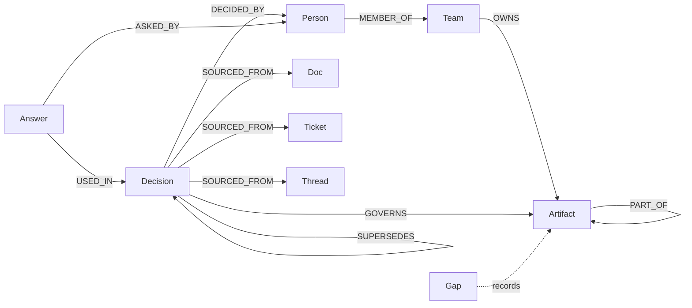

# Gatekeeper graph schema

The fixture is synthetic. Public/curated ingestion must set provenance honestly rather than inheriting the fixture label.

## Nodes

| Label | Required properties | Optional properties |
| --- | --- | --- |
| `Decision` | `id`, `title`, `status` (`live`, `superseded`, `withdrawn`), `decided_at` | `synthetic` |
| `Artifact` | `id`, `kind` (`repo`, `module`, `file`, `package`, `service`, `config`), `name` | `synthetic` |
| `Person` | `handle` | `synthetic` |
| `Team` | `name` | `synthetic` |
| `Doc` / `Ticket` / `Thread` | `id`, `url` | `title`, `provenance` (`REAL`, `CURATED`, `SYNTHETIC`), `synthetic` |
| `Answer` | `id`, `at`, `kind` (`answer`, `check`), `summary`, `session` | `target`, `action`, `verdict`, `synthetic` |
| `Gap` | `id`, `at`, `reason`, `target` | `synthetic` |

`Answer.target`, `Answer.action`, and `Answer.verdict` are engine-owned additive properties. They make graph-derived reversal previews possible without claiming that the ledger is causal evidence.

## Edges

| Edge | Direction | Properties |
| --- | --- | --- |
| `DECIDED_BY` | Decision → Person | `provenance` optional; missing defaults to `SYNTHETIC` |
| `SOURCED_FROM` | Decision → Doc/Ticket/Thread | `provenance` optional |
| `SUPERSEDES` | new Decision → old Decision | `provenance` optional |
| `DEPENDS_ON` | Decision → premise Decision | `provenance` (`REAL`, `CURATED`, `SYNTHETIC`) |
| `GOVERNS` | Decision → Artifact | `constraint`, `actions`, `severity`, `provenance` |
| `PART_OF` | child Artifact → parent Artifact | `provenance` optional |
| `OWNS` | Team → Artifact | `provenance` optional |
| `MEMBER_OF` | Person → Team | `provenance` optional |
| `USED_IN` | Answer → Decision | `provenance` optional |
| `ASKED_BY` | Answer → Person | `provenance` optional |

`GOVERNS.constraint` is `prohibits`, `requires_approval`, or `informational`. `GOVERNS.actions` is a comma-separated action list or `*`. `GOVERNS.severity` is `high` or `normal`.

## Indexes

The verified FalkorDB v4.22.1 syntax is:

```cypher
CREATE INDEX FOR (d:Decision) ON (d.id)
CREATE INDEX FOR (a:Artifact) ON (a.id)
CREATE INDEX FOR (p:Person) ON (p.handle)
```

The current fixture does not create them automatically because a shared graph may already have indexes. Run once during deployment/ingestion.

## Data model


